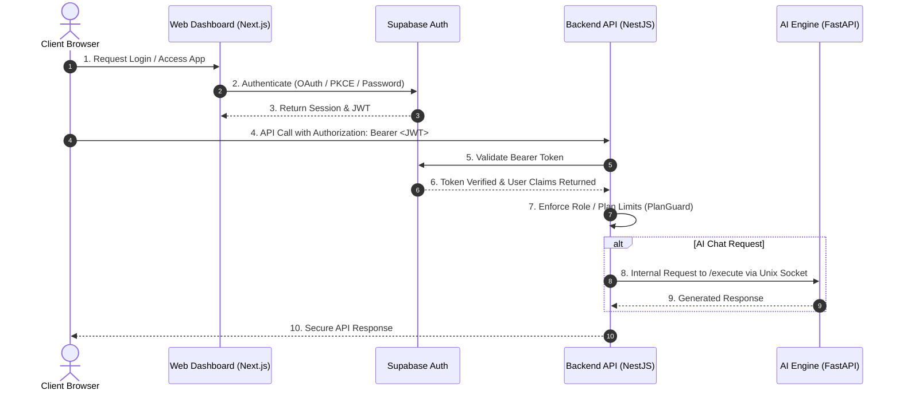

# VultaCore — System Architecture & Component Interactions

## 1. High-Level Architecture Diagram

```
[ Browser / Client ] ──(HTTPS/WSS)──▶ [ Cloudflare CDN & WAF ]
                                              │
                                              ▼
                             [ Hostinger Cloud (LiteSpeed) ]
                                              │
                                              ▼
                                   [ Master Proxy: server.js ]
                                ┌─────────────┼─────────────┐
                                │             │             │
                                ▼             ▼             ▼
                       [ web-dashboard ] [ backend-api ] [ ai-services ]
                        Next.js Standalone  NestJS Core   FastAPI Python
                                │             │                 │
                                ▼             ▼                 ▼
                          Supabase Auth   saas.sqlite    External AI APIs
                          & Storage       (or Postgres)  (Gemini / Groq)
```

---

## 2. Component Directory Reference

* [**`server.js`**](file:///home/hacker/Documents/Projects/SaaS%202.0/tri-stack/server.js): Entry point for Phusion Passenger. Spawns child engines and tunnels HTTP/WebSocket traffic through Unix sockets.
* [**`web-dashboard/`**](file:///home/hacker/Documents/Projects/SaaS%202.0/tri-stack/web-dashboard): Next.js 15 App Router frontend with Tailwind CSS and Supabase SSR authentication.
* [**`backend-api/`**](file:///home/hacker/Documents/Projects/SaaS%202.0/tri-stack/backend-api): NestJS 11 backend service providing REST endpoints, WebSockets, TypeORM persistence, and Lemon Squeezy billing.
* [**`ai-services/`**](file:///home/hacker/Documents/Projects/SaaS%202.0/tri-stack/ai-services): Python FastAPI engine managing dynamic fallback prompts across Gemini 3.8 Flash, Groq LLaMA, and OpenRouter.
* [**`infra/`**](file:///home/hacker/Documents/Projects/SaaS%202.0/tri-stack/infra): Terraform IaC configurations and hardened Kubernetes manifests.
* [**`docs/`**](file:///home/hacker/Documents/Projects/SaaS%202.0/tri-stack/docs): Complete DevSecOps and incident response documentation.

---

## 3. Data Flow & Authentication Lifecycle



